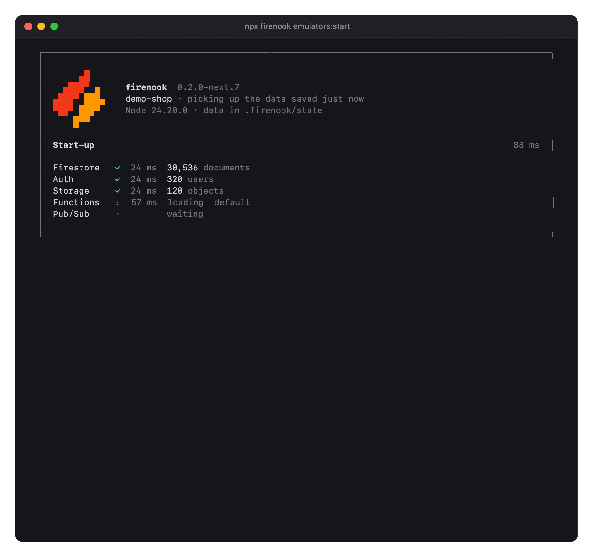
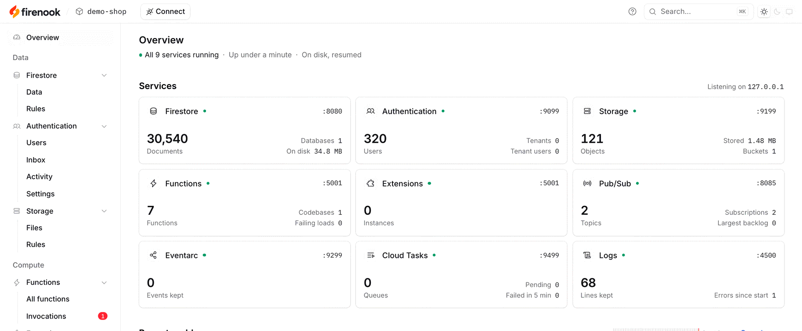
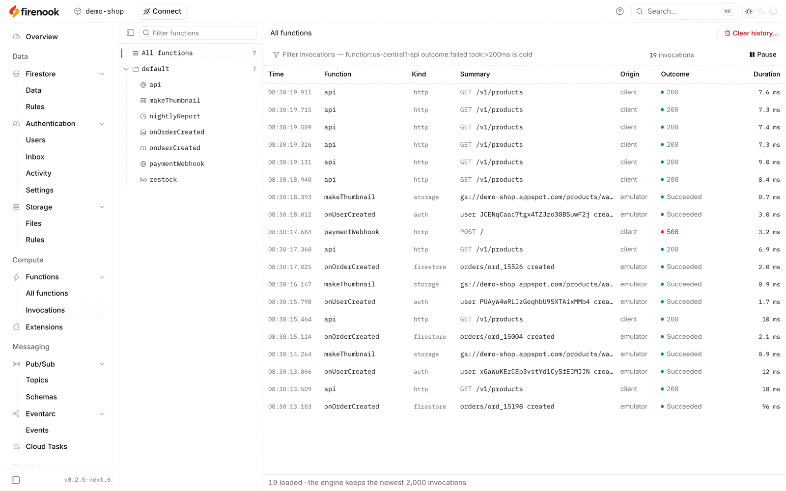
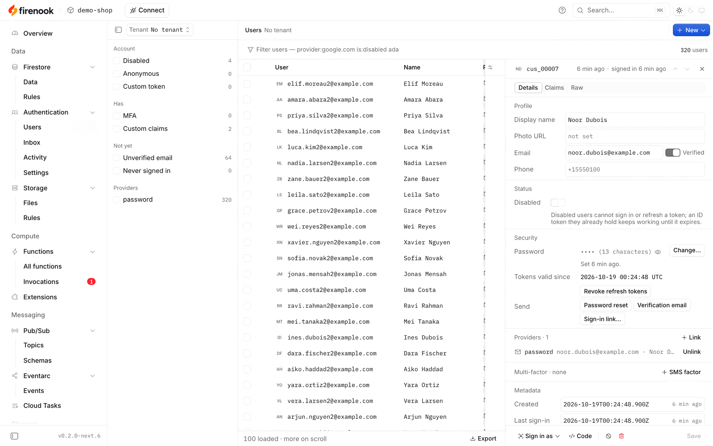
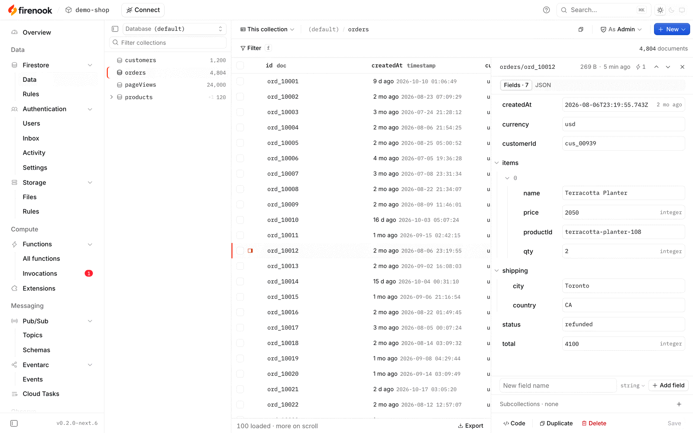
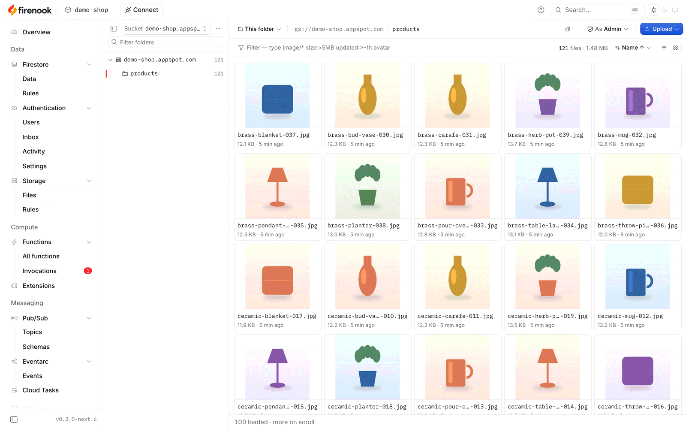
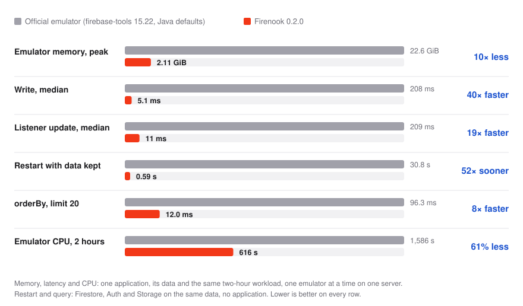

<p align="center">
  <picture>
    <source media="(prefers-color-scheme: dark)" srcset="brand/logo/firenook-logo-on-dark.svg">
    
  </picture>
</p>

<h3 align="center">A drop-in replacement for the Firebase Local Emulator Suite</h3>

<p align="center">
  Keep your <code>firebase.json</code>, SDKs and ports. Get 38× faster writes,
  9× less memory, no Java, and data that survives restarts.
</p>

<p align="center">
  <a href="https://www.npmjs.com/package/firenook"></a>
  <a href="LICENSE"></a>
  
</p>

<p align="center">
  <a href="docs/getting-started.md">Getting started</a> ·
  <a href="docs/README.md">Docs</a> ·
  <a href="docs/benchmarks.md">Benchmarks</a> ·
  <a href="COMPATIBILITY.md">Compatibility</a> ·
  <a href="https://github.com/firenook-dev/firenook/releases">Releases</a>
</p>

<p align="center">
  
</p>

**Already using the Firebase emulators?** Install Firenook and change one word:

```sh
npm install --save-dev firenook
```

```diff
- firebase emulators:start --import ./data
+ firenook emulators:start --import ./data
```

Same flags, same ports, and your `firebase.json`, rules, Functions code and app
stay as they are. In a terminal, run it as `npx firenook emulators:start`.
Starting a new project? `npx firenook init` sets one up.
[Get started](#get-started) covers both.

## Why Firenook

**A drop-in for the official emulator.** Firenook reads `firebase.json`,
`.firebaserc`, rules and indexes the way the Firebase CLI does, serves
Firestore, Auth, Storage, Functions, Pub/Sub, Cloud Tasks and Eventarc on the
same ports, and your client and Admin SDKs connect unchanged. It imports and
exports the official format, so your data moves both ways. Every change is
checked against recorded behaviour of the official emulator.

**Fast and light.** The services are native Rust and the data lives on disk,
not in a Java heap. On a real application's two-hour workload, the emulator
peaked at 2.16 GiB of memory against 19.56 GiB, answered writes in 5.3 ms
against 203 ms at the median, and used 61% less CPU.

**Your data stays.** Start again and Firestore, Auth and Storage are back with
all your data in about half a second, even with millions of documents. No
export at every stop, no import at every start. Acknowledged writes are durable within a
second, and a stop always closes the data cleanly.

**One package, nothing else to install.** No Java, no firebase-tools, nothing
downloaded at install or start: one npm package with a native engine for
macOS, Linux and Windows. Node runs your Functions, as in production.

**A console and a terminal made for it.** A web console for every service,
live as your app runs, and a terminal screen that shows each function call,
what triggered it, how long it took, and the stack trace when it fails.

**Ready for your agent.** `firenook mcp` gives a coding agent the running
suite: read and write Firestore, manage users and their codes, list Storage,
invoke functions, publish to Pub/Sub. Nothing leaves your machine.

## The console

**The console the Firebase emulators should have had.** Google's Emulator UI
has no page for your Functions, Pub/Sub, Cloud Tasks or Eventarc, only a log.
Firenook's console covers every service it runs, live, on the same port, at
<http://127.0.0.1:4000/console>:

- **Functions:** every call with what triggered it, its outcome, its duration
  and its logs, and every schedule. The official UI has only the log.
- **Authentication:** users, their activity, and an inbox of the sign-in codes
  and email links Auth would have sent, so you never dig through the terminal
  for them.
- **Firestore and Storage:** browse, edit and upload, and read their
  security rules.
- **Pub/Sub, Cloud Tasks and Eventarc,** which the official UI has no pages
  for.
- **An Overview** of every service's health and recent problems, with
  snapshots and resets a click away.

Light and dark, works offline, sends nothing anywhere. Bookmarks to the
official UI's pages open the matching console page.

<picture>
  <source media="(prefers-color-scheme: dark)" srcset="docs/assets/console-overview-dark.png">
  
</picture>

| Function invocations | Authentication |
| --- | --- |
| <picture><source media="(prefers-color-scheme: dark)" srcset="docs/assets/console-invocations-dark.png"></picture> | <picture><source media="(prefers-color-scheme: dark)" srcset="docs/assets/console-auth-dark.png"></picture> |
| **Firestore** | **Storage** |
| <picture><source media="(prefers-color-scheme: dark)" srcset="docs/assets/console-firestore-dark.png"></picture> | <picture><source media="(prefers-color-scheme: dark)" srcset="docs/assets/console-storage-dark.png"></picture> |

More in [the console guide](docs/console.md).

## Benchmarks

The same application, data and two-hour workload on one server, one emulator
at a time; then each emulator on its own with the same data.

<picture>
  <source media="(prefers-color-scheme: dark)" srcset="docs/assets/benchmark-dark.svg">
  
</picture>

The official emulator answered 6 of 26 query shapes faster: ordering and range
filters over a large collection, and batch gets of many documents. The method,
every figure and those limits are in [the benchmarks](docs/benchmarks.md).

## What it emulates

| Service | Highlights |
| --- | --- |
| Firestore | Native and web SDKs, realtime listeners, Security Rules, named databases, official import and export |
| Authentication | Every operation of the official Auth emulator: password, email link, phone, anonymous, custom tokens, test sign-in with Google, Apple and other providers, MFA, passkeys, tenants, blocking functions |
| Cloud Storage | Firebase and Cloud Storage APIs, Security Rules evaluated natively, including `firestore.get()` and `exists()` |
| Cloud Functions | HTTP, callable and streaming functions; Firestore, Storage, Auth, Pub/Sub, Eventarc, schedule and task-queue triggers; reload on save; `--inspect-functions`; `functions:invoke` for any trigger |
| Extensions | Local, vendored or registry sources, offline once vendored |
| Pub/Sub | Every RPC over gRPC and HTTP/JSON: push, ordering, filters, dead-letter topics, seek, snapshots, Avro schemas |
| Cloud Tasks | Queues for `onTaskDispatched` with the official retry and rate-limit behaviour |
| Eventarc | Custom events delivered to `onCustomEventPublished` |

Realtime Database, Hosting, App Hosting and Data Connect are not emulated; a
`firebase.json` that configures them still starts, with a warning.
[COMPATIBILITY.md](COMPATIBILITY.md) records what each service covers and what
it does not.

## Get started

### Already using the Firebase emulator

Firenook is a drop-in replacement: `firebase.json`, `.firebaserc`, your rules,
your Functions code and your app stay exactly as they are.

**1. Install it** in the project, next to firebase-tools (keep that for
deploying):

```sh
npm install --save-dev --save-exact firenook    # or: bun add --dev --exact firenook
```

**2. Check your project.** This reads `firebase.json` the way the Firebase CLI
does and changes nothing:

```console
$ npx firenook init --adopt --dry-run
  skip    Firenook: firebase.json configures the hosting emulator, which Firenook does not implement; skipping it.
  ok      nothing to change; services: firestore, auth, storage, functions
```

It names any service Firenook skips (Realtime Database, Hosting, App Hosting,
Data Connect) and any addition it would make, such as a missing `emulators`
entry; `npx firenook init --adopt` applies those additions.

**3. Swap the command.** Same flags, same ports, and the same export format, so
your existing data imports as it is:

```diff
 "scripts": {
-  "emulators": "firebase emulators:start --import ./data --export-on-exit",
-  "test:integration": "firebase emulators:exec \"npm test\""
+  "emulators": "firenook emulators:start --import ./data --export-on-exit",
+  "test:integration": "firenook emulators:exec \"npm test\""
 }
```

Your app connects to the same ports as before, so no code changes:
`connectFirestoreEmulator(db, '127.0.0.1', 8080)`, `FIRESTORE_EMULATOR_HOST`
and the rest work unchanged.

**4. Optionally, stop exporting at every stop.** In place of
`--export-on-exit`, give Firenook a state directory and it keeps your data
between runs. Every start after the first picks the data up where you left
it, and `./data` itself stays untouched:

```sh
npx firenook emulators:start --import ./data --state-dir ./.firenook/state --resume-state
```

Going back is just as short: stop Firenook (it saves first), export with
`npx firenook emulators:export ./export`, and start the official CLI on that
export.

### Starting a new project

```sh
npm install --save-dev --save-exact firenook
npx firenook init                       # firebase.json, rules, indexes and a Functions codebase
cd functions && npm install && cd ..
npx firenook emulators:start
```

`init` sets up every emulator on its usual port with a `demo-<folder>` project,
so nothing can reach a real Firebase project. Point your app at it:

```js
connectFirestoreEmulator(db, '127.0.0.1', 8080);
connectAuthEmulator(auth, 'http://127.0.0.1:9099');
connectStorageEmulator(storage, '127.0.0.1', 9199);
connectFunctionsEmulator(functions, '127.0.0.1', 5001);
```

Firenook needs Node 24 on macOS, Linux (glibc) or Windows x64. The
[getting started guide](docs/getting-started.md) covers each step in more
depth, including tests and keeping data.

## Documentation

- [Getting started](docs/getting-started.md) · [The terminal](docs/terminal.md)
  · [The console](docs/console.md) · [Configuration](docs/configuration.md)
- [Functions and Extensions](docs/functions-and-extensions.md) ·
  [Data, state and tests](docs/data-and-state.md) ·
  [Model Context Protocol](docs/mcp.md) · [CLI reference](docs/cli.md)
- [Benchmarks](docs/benchmarks.md) · [Compatibility](COMPATIBILITY.md) ·
  [Versions and verification](docs/versions-and-verification.md) ·
  [Roadmap](ROADMAP.md) · [Design](DESIGN.md)

## Status

Firenook is in preview: releases are `0.2.0-next` versions on npm. Every
release passes conformance replays against the official emulator and packed
installs on all five platforms, and releases are measured against the official
emulator with a real application (most recently 0.2.0-next.6, in the
[benchmarks](docs/benchmarks.md)). Pin an exact version and upgrade on purpose; [the releases](https://github.com/firenook-dev/firenook/releases)
list what each one carries.

## Contributing

Firenook is built in the open under the Apache License 2.0.
[CONTRIBUTING.md](CONTRIBUTING.md) explains how a change moves, from a
recorded fixture of the official emulator to a release, and how to build and
test from source. Report a bug or ask for a feature in the
[issues](https://github.com/firenook-dev/firenook/issues).

## License and trademarks

Firenook is licensed under the [Apache License 2.0](LICENSE); see
[NOTICE](NOTICE) for the reference-only sources studied and
[TRADEMARKS.md](TRADEMARKS.md) for the use of the Firenook name and mark.
Firebase, Cloud Firestore, Cloud Functions, Cloud Storage, Cloud Pub/Sub and
Cloud Tasks are trademarks of Google LLC. Firenook is not affiliated with or
endorsed by Google.

Firenook (formerly Fireside) is the same project under its new name;
[the former name](docs/former-name.md) says how to move from the packages
published before the rename.
