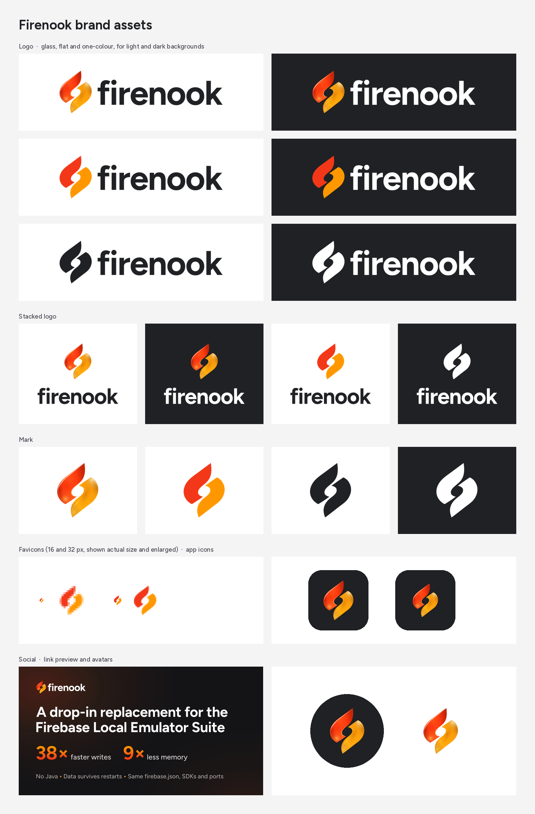

# Firenook brand assets



Everything here is generated by `source/build_brand.py` from one master: the
liquid-glass twin-flame mark and the Figtree Bold wordmark. All SVGs are plain
paths and gradients: no embedded images, no live text, no filters, and no fonts
needed to display them.

## Which file to use

| Need | File |
| --- | --- |
| Default logo (website header, README, docs) | `logo/firenook-logo.svg` |
| Logo on a dark background | `logo/firenook-logo-on-dark.svg` |
| Small UI, docs, print, anything that can't show gradients | `logo/firenook-logo-flat.svg` / `-flat-on-dark.svg` |
| One-colour use (stamps, partner pages, embossing, photos) | `logo/firenook-logo-mono-charcoal.svg` / `-mono-white.svg` |
| Square or centred spaces (title slides, posters) | `logo/firenook-logo-stacked*.svg` |
| The flames on their own | `mark/firenook-mark.svg` (plus `-flat`, `-mono-charcoal`, `-mono-white`) |
| The name on its own | `wordmark/firenook-wordmark.svg` / `-white.svg` |
| Somewhere that only takes PNG | the matching file in each folder's `png/` |
| Website favicons | everything in `favicon/` (see below) |
| GitHub org, npm org, X, Discord avatar | `social/avatar-dark-1024.png` (or `avatar-light-1024.png`) |
| GitHub repo → Settings → Social preview | `social/github-social-preview-1280x640.png` |
| Website `og:image` / `twitter:image` | `social/og-image-1200x630.png` |

## Favicons

Copy every file in `favicon/` to the site root and paste `favicon/head.html` into
`<head>`:

```html
<link rel="icon" href="/favicon.ico" sizes="32x32">
<link rel="icon" href="/favicon.svg" type="image/svg+xml">
<link rel="apple-touch-icon" href="/apple-touch-icon.png">
<link rel="manifest" href="/site.webmanifest">
<meta name="theme-color" content="#202124">
```

`favicon.svg` and the 16/32 px frames of `favicon.ico` use a version of the flat
mark tuned for tiny sizes: each flame is about 1.4% thinner, so the gap between
them stays open in a browser tab. Use it only for favicons. The app icons (Apple
touch, 192, 512 and the Android maskable icon) put the glass mark on charcoal.

## Colour

| Name | Hex | Use |
| --- | --- | --- |
| Vermilion | `#F23818` | upper flame (flat) |
| Amber | `#FF9800` | lower flame (flat) |
| Charcoal | `#202124` | wordmark, one-colour logo, dark backgrounds, theme colour |
| White | `#FFFFFF` | wordmark on dark |
| Night | `#141416` | social-image background |

The glass flames are gradients built around vermilion and amber; their exact
stops live in the SVGs.

## Type

The wordmark is **Figtree Bold**, letter-spaced −0.025em and converted to
outlines. Use Figtree for headings and UI text next to the logo, too.
Figtree is under the SIL Open Font License 1.1 (`source/fonts/Figtree-OFL.txt`),
which allows logo use; get it from Google Fonts.

## Usage

- **Clear space:** keep other elements at least as far away as the padding built
  into the files, which is about a quarter of the mark's width on every side.
- **Minimum size:** horizontal logo 120 px wide (25 mm in print); stacked logo
  80 px wide; glass mark 32 px. Below 32 px use the favicon files or the flat mark.
- Don't recolour, rotate, flip, stretch or outline the flames, and don't add
  shadows or effects to the flat and one-colour versions.
- Don't retype "firenook" in another font or change the spacing; use the files.
- On photos or busy backgrounds use a one-colour version.
- Firenook is Firebase-compatible but not affiliated with Google or Firebase.
  Never place Firebase or Google logos inside a Firenook lockup.

## In this repository

The console wears the kit by copy: `console/public/` holds the files of
`favicon/` (with its own `site.webmanifest`, whose addresses are relative to
`/console/`), and the top bar's logo, `console/src/components/kit/firenook-logo.tsx`,
draws `logo/firenook-logo-flat.svg`'s paths. `console/src/brand.test.ts` fails
when a copy no longer matches, so after a rebuild copy the changed files over.

## Rebuilding

```sh
cd brand/source
python3 -m venv .venv && .venv/bin/pip install -r requirements.txt
brew install librsvg imagemagick   # rsvg-convert renders the PNGs, magick packs favicon.ico
.venv/bin/python build_brand.py    # regenerates logo/, mark/, wordmark/, favicon/, social/, overview.png
```

`source-tailored.svg` is the approved Tailored Glass artwork the mark is polished
from. `stage1.py` refits its outlines and `stage2.py` rebuilds the edge highlights.
The social card's headline, figures and points, and the palette, are constants
at the top of `build_brand.py`. The figures come from
`benchmarks/next6-paired-acceptance.json`; change them only with a new receipt.
