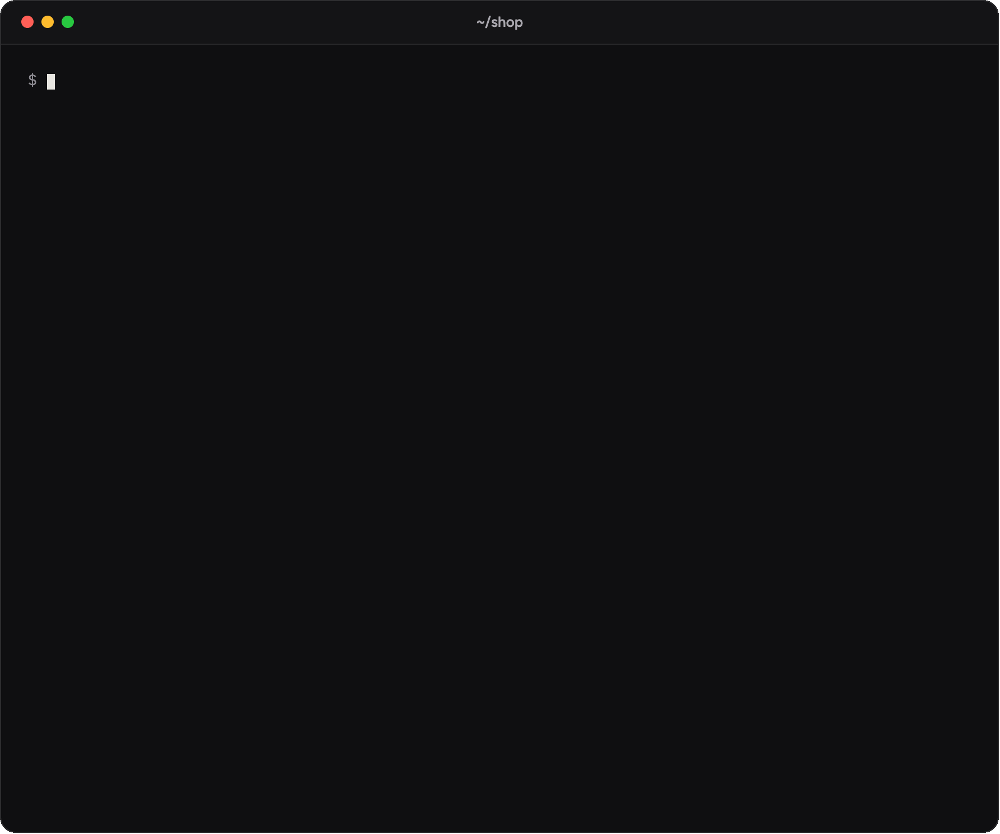

# The terminal

[Docs](README.md) · The terminal

What `firenook emulators:start` and `firenook init` draw in a terminal, the keys they answer, and the plain output pipes and CI get.

In a terminal, `firenook emulators:start` draws its own screen:

- a card with the start-up, one row per service, filling in with how long
  each took and what it holds (documents, users, objects, functions), and
  with `--build` a first row for the compile;
- the ready summary: the console's address, the ports, any start-up
  warnings, and a newer release when one is out;
- the log below it, one line per call with how long it took and what caused
  it, the function's own output under it, reloads as you save, each
  service's own lines (Auth's sign-in codes and links, a Storage or Cloud
  Tasks warning), and with `--build` each compile's errors, with where they
  are;
- a footer that stays on the window's last line, with the keys.

| Key | Does |
| --- | --- |
| `o` | opens the console in your browser |
| `r` | reloads your functions |
| `e` | exports a snapshot of the data to `.firenook/exports/<time>` |
| `w` | lists the start-up warnings |
| `?` | shows the keys, and how to connect a coding agent (`npx firenook mcp add`) |
| `q` or Ctrl-C | stops Firenook, saving the data first |

When Firenook cannot start, the card says what went wrong, how to fix it and
what became of the data, and the command exits with code 1. A port someone
else holds names the program and its process id, with the command that
stops it and a free port for `firebase.json`. Saved data refused because its
seed changed names the files that changed, with the command that keeps the
data. A repair after an unclean stop shows how far it has got, and a stop
while Firenook is still starting closes the data before it exits.

When your functions do not load, what happens depends on when. At the
start, a project whose `firebase.json` has a Functions codebase asks for at
least one function (the launcher passes `--minimum-functions 1`): when no codebase
loads any, Firenook does not start, and the card says the runtime found
none, with the load error under it. Fix it and start again, or start with
`--minimum-functions 0` to run the rest without them. When some do load
(another codebase, an Extension), a codebase that does not is shown on the
card with its error and the code around it, every emulator runs, and the
next save loads it again. Once the emulators are running, a save that does
not load is a line of the log with its error, and the version loaded before
it, if there is one, keeps answering; nothing stops.

`firenook init` draws the same card: the mark, then the new project's
choices as rows, each already made. `↑` `↓` (or Tab) move between rows,
`←` `→` change a choice, Space turns one of several on or off, letters edit
the project id, Enter goes on and Esc leaves without writing anything. The
row in focus has its hint under it, and an answer that cannot be used says
why there. The set-up then runs as rows of the card, like the start-up, and a
yes to "Start the emulators now?" hands the same terminal to the start
screen. In a folder with a `firebase.json`, the card shows what
`init --adopt` would add and asks before adding it.

Pipes, CI, log files and `emulators:exec` get the plain line protocol, the
same lines as before, `All emulators ready` alone on its line. So do
`--plain`, `FIRENOOK_PLAIN=1` and `TERM=dumb`; `init` there writes the files
and prints the commands that finish the set-up, or does it with `--yes`. `NO_COLOR` keeps the screen
and drops the colour. Terminals that cannot draw its symbols (the Windows
console outside Windows Terminal, the Linux text console, or
`FIRENOOK_ASCII=1`) get plain characters instead.

The release check asks the npm registry for `firenook`'s version tags at
most once a day, in the background. The answer shows on the next start, so
the check never slows a start down. It follows the channel of the version
you have (`next` or `latest`; a preview also hears of a later release on
`latest`) and writes the install command for your project's package manager. It is off in CI, in the plain output, and with
`FIRENOOK_NO_UPDATE_CHECK=1` or `NO_UPDATE_NOTIFIER=1`. As elsewhere, a
variable set to nothing, `0` or `false` is not set: `CI=false` is no CI.
